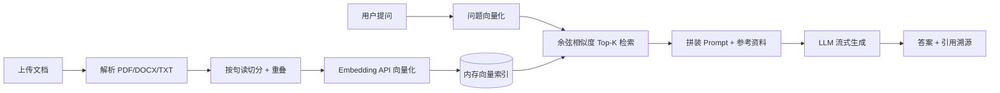

# 文档智能问答系统（RAG）

上传文档 → 自动切分向量化 → 基于内容回答 → **每条结论标注原文出处**。

一个完整可跑通的 RAG 最小闭环：不依赖 LangChain 等重型框架，只用 `requests + numpy` 实现检索层，逻辑透明、可逐行讲清楚。

## 在线 Demo

> 部署后把链接填在这里：[https://your-app.streamlit.app](https://rag-doc-app-awugwunppu9i5h2ghmnvg2.streamlit.app
)

## 功能

| 能力 | 说明 |
|---|---|
| 多格式解析 | PDF（含分页）、DOCX（含表格）、TXT、MD |
| 中文友好切分 | 按句读切分，保留 80 字上下文重叠，避免句子被截断 |
| 向量检索 | 文本向量化后归一化做余弦相似度检索，纯 NumPy 实现 |
| 带引用生成 | 答案中标注 `[1][2]`，可展开查看命中的原文段落与相关度 |
| 多轮对话 | 携带最近 3 轮上下文，支持追问 |
| 兜底策略 | 检索不到相关内容时明确拒答，不编造 |

## 架构



## 本地运行

```bash
pip install -r requirements.txt

# Windows PowerShell
$env:API_KEY="5cd6f536b43c4f5b898d5c4c82cee7c3.LejOdxx4GZpL5lbO"
streamlit run app.py
```

## 部署到 Streamlit Community Cloud

1. 把本目录推到 GitHub 仓库
2. [share.streamlit.io](https://share.streamlit.io) → New app → 选择仓库和 `app.py`
3. App settings → Secrets，填入：

```toml
API_KEY = "你的key"
```

4. Deploy，等待构建完成拿到公网链接

## 模型配置

默认使用智谱开放平台（`embedding-3` 向量 + `glm-4-flash` 对话，均有免费额度），**开箱即用，只需提供一个 Key**。

Key 按以下顺序查找，命中任意一个即可：

```
CHAT_API_KEY / EMBED_API_KEY  →  API_KEY  →  ZHIPU_API_KEY
```

本地如果已有 `ZHIPU_API_KEY` 环境变量（智谱官方 SDK 会写入），无需任何额外配置。

所有调用走 OpenAI 兼容协议，换厂商只改 Secret，不改代码：

```toml
API_BASE       = "https://open.bigmodel.cn/api/paas/v4"   # 默认值，可省略
API_KEY        = "xxx"
CHAT_MODEL     = "glm-4-flash"                            # 默认值，可省略
EMBED_MODEL    = "embedding-3"                            # 默认值，可省略

# 向量和对话分别用不同厂商时（例如向量用智谱、对话用 DeepSeek）
# CHAT_API_BASE  = "https://api.deepseek.com/v1"
# CHAT_API_KEY   = "sk-xxx"
# CHAT_MODEL     = "deepseek-chat"
```

配置完成后先跑连通性自检，比部署后排查省事：

```bash
python check_api.py
```

输出会显示实际生效的模型、向量维度、及对话模型的一句话回复；报错时直接给出原因（Key 无效 / 余额不足 / 网络不通）。

## 目录结构

```
rag-doc-qa/
├── app.py                # Streamlit 界面与交互流程
├── rag_core.py           # 解析 / 切分 / 向量化 / 检索 / 生成
├── check_api.py          # API 连通性自检
├── requirements.txt
└── .streamlit/config.toml
```

`rag_core.py` 与界面完全解耦，可以单独 `import` 做批量问答或接入 FastAPI。

## 已知限制

- 扫描版 PDF 无文字层，需先 OCR，当前会给出明确报错
- 索引存在内存中，刷新页面需重新上传（Demo 阶段取舍，换成持久化只需替换 `VectorIndex`）
- 单文件 20MB 上限，超长文档建议拆分
