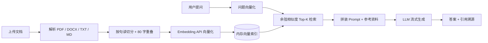

# 文档智能问答系统（RAG）

上传文档 → 自动切分向量化 → 基于内容回答 → **每条结论标注原文出处**

一个完整可跑通的 RAG 最小闭环。不依赖 LangChain 等重型框架，检索层用 `requests + NumPy` 手写实现，**每个环节的逻辑都能逐行讲清楚**。

[](https://rag-doc-app-awugwunppu9i5h2ghmnvg2.streamlit.app)
[](https://www.python.org/)
[](LICENSE)

---

## 在线 Demo

**https://rag-doc-app-awugwunppu9i5h2ghmnvg2.streamlit.app**

模型已预配置，打开即可上传文档体验，无需自备 API Key。

> 数据仅在内存中处理，刷新页面即清空，不上传、不落盘。

---

## 功能

| 能力 | 说明 |
|---|---|
| 多格式解析 | PDF（保留分页信息）、DOCX（含表格结构）、TXT、Markdown |
| 中文友好切分 | 按中文句读切分，保留 80 字上下文重叠，避免句子被硬截断 |
| 向量检索 | 文本向量化后归一化，余弦相似度 Top-K 召回，纯 NumPy 实现 |
| 带引用生成 | 答案中标注 `[1][2]`，可展开查看命中的原文段落与相关度得分 |
| 多轮对话 | 携带最近 3 轮上下文，支持追问 |
| 兜底拒答 | 检索不到相关内容时明确拒答，不编造 |
| 开箱自检 | 内置 API 连通性检查脚本，报错直接给原因 |

---

## 架构



---

## 关键技术取舍

这部分是这个项目与"调包 Demo"的区别所在。

### 1. 为什么不用 LangChain

框架把检索过程抽象成了黑盒：你调一个 `retriever.invoke()`，拿到几段文本，但不知道它是怎么切的、相似度取了多少、为什么这几段被选中。

这个项目需要的是**可解释性**——答案要能溯源到原文第几段，就必须自己控制召回的每一步。所以检索层用 `requests` 调 Embedding API、用 `NumPy` 做归一化和余弦相似度计算，索引结构、Top-K 策略、得分阈值全部可见、可调、可调试。

代价是要自己处理向量归一化、批量请求和内存占用；收益是出问题时能定位到具体环节，而不是从框架文档里猜。

### 2. 切分为什么是 80 字重叠

固定长度切分会把句子从中间切断，导致召回后语义残缺——检索到了，但模型看到的半句话。

按中文句读（。！？；\n）切分保证句子完整；再用 80 字重叠保证跨段落的语义连续。80 是实测出来的经验值：低于 50 时，跨句追问的召回率明显下降；高于 120 时，索引体积和 Token 成本上涨，收益不再明显。

### 3. 引用溯源怎么做

召回时保留每个 chunk 的原文、页码/段落序号和相似度得分，随 Prompt 一起传给模型，要求它输出时用 `[1][2]` 标注。前端把编号和 chunk 对应起来，点击即可展开原文。

**这不能保证模型 100% 不编造引用**，但能让用户立刻核验——这是比"相信模型"更实用的一步。

### 4. 拒答策略

设定相似度阈值，Top-K 最高分低于阈值时直接返回"未在文档中找到相关内容"，不送进模型。宁可拒答，也不给一个看起来很像的幻觉答案。

---

## 快速开始

```bash
git clone https://github.com/chen20011015/rag-doc-qa.git
cd rag-doc-qa
pip install -r requirements.txt
```

配置 API Key（**不要写进代码或提交到仓库**）：

```bash
# Windows PowerShell
$env:API_KEY = "你的key"

# macOS / Linux
export API_KEY="你的key"
```

运行：

```bash
python check_api.py      # 先自检，确认 Key / 余额 / 网络都正常
streamlit run app.py
```

浏览器打开 http://localhost:8501

### 模型配置

默认使用智谱开放平台（`embedding-3` 向量 + `glm-4-flash` 对话，均有免费额度），开箱即用，只需一个 Key。

所有调用走 OpenAI 兼容协议，换厂商只改环境变量，不改代码：

| 变量 | 说明 | 默认值 |
|---|---|---|
| `API_BASE` | 接口地址 | `https://open.bigmodel.cn/api/paas/v4` |
| `API_KEY` | 密钥 | 必填 |
| `CHAT_MODEL` | 对话模型 | `glm-4-flash` |
| `EMBED_MODEL` | 向量模型 | `embedding-3` |

也支持向量与对话用不同厂商，例如向量用智谱、对话用 DeepSeek：

```bash
$env:CHAT_API_BASE = "https://api.deepseek.com/v1"
$env:CHAT_API_KEY  = "sk-xxx"
$env:CHAT_MODEL    = "deepseek-chat"
```

---

## 部署到 Streamlit Community Cloud

1. 把仓库推到 GitHub
2. [share.streamlit.io](https://share.streamlit.io) → **New app** → 选择仓库和 `app.py`
3. **App settings → Secrets**，填入：

```toml
API_KEY = "你的key"
```

4. Deploy，构建完成后拿到公网链接

密钥通过 Secrets 注入，不出现在代码和 Git 历史里。

---

## 目录结构

```
rag-doc-qa/
├── app.py                 # Streamlit 界面与交互流程
├── rag_core.py            # 解析 / 切分 / 向量化 / 检索 / 生成
├── check_api.py           # API 连通性自检
├── requirements.txt
└── .streamlit/
    └── config.toml
```

`rag_core.py` 与界面完全解耦，可以单独 `import` 做批量问答，或接入 FastAPI 提供服务。

---

## 已知限制

诚实地列出边界，比宣称"完美"更可信。

- **扫描版 PDF 不支持**：没有文字层，需先 OCR，当前会给出明确报错而不是静默失败
- **索引在内存**：刷新页面需重新上传，这是 Demo 阶段的取舍；换持久化只需替换 `VectorIndex` 实现
- **纯内存精确检索**：数据量到十万级后，NumPy 全量余弦计算会成为瓶颈
- **单文件上限 20MB**：超长文档建议拆分后分批上传

## 后续计划

- [ ] 召回后加 Rerank 重排，提升 Top-K 精度
- [ ] 向量索引持久化（FAISS / pgvector），支持增量入库
- [ ] 构建评测集（QA 对 + 命中率 / 忠实度指标），量化效果而非凭感觉
- [ ] chunk 按标题层级切分，替代固定句读切分

---

## License

MIT
